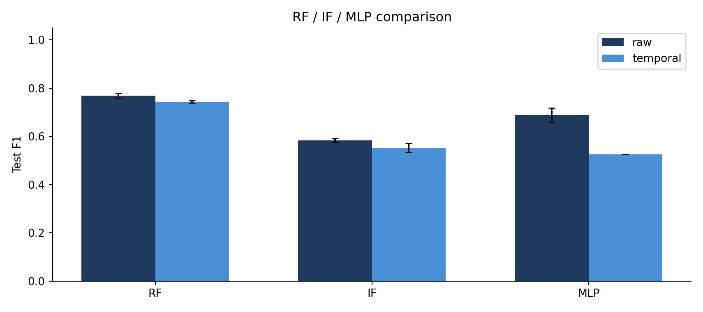
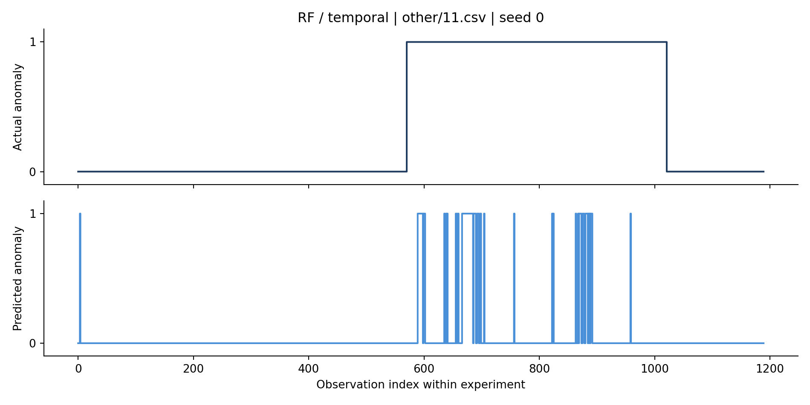
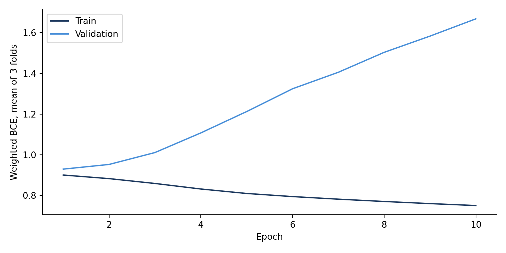
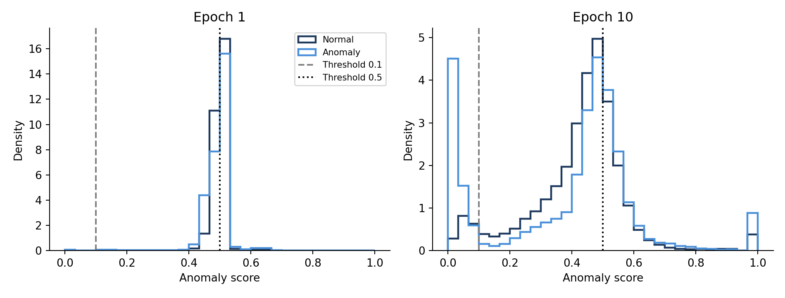

# SKAB Industrial Anomaly Detection

This repository contains a machine learning project for industrial equipment anomaly detection using the Skoltech Anomaly Benchmark (SKAB).

The project compares Random Forest (RF), Isolation Forest (IF), and Multilayer Perceptron (MLP) models to investigate the effectiveness of temporal features derived from industrial sensor data.

## Project Overview

- Detect abnormal conditions using multivariate industrial sensor data.
- Compare Random Forest, Isolation Forest, and MLP models.
- Investigate the effects of adding temporal features.
- Select model configurations and anomaly thresholds using file-level cross-validation.
- Analyze the causes of excessive anomaly predictions in the MLP model.

## Dataset

- Dataset: Skoltech Anomaly Benchmark (SKAB v0.9)
- Source: [SKAB GitHub Repository](https://github.com/waico/SKAB)
- Number of experiment files: 34
- Number of observations: 37,401
- Number of sensor variables: 8
- Target: `anomaly` (0: Normal, 1: Anomaly)

The dataset contains vibration, current, pressure, temperature, voltage, and flow rate measurements collected from an industrial testbed.

The required CSV files are automatically downloaded from a fixed commit of the official repository when the notebooks are executed.

Dataset commit: `b2c0d46c2971dcbfe71e26087b6d231998bb91c2`

## Project Structure

```text
skab-industrial-anomaly-detection
│
├── notebooks
│   ├── 01_baseline_experiment.ipynb
│   ├── 02_model_comparison.ipynb
│   └── 03_mlp_diagnostic.ipynb
│
├── results
│   ├── baseline
│   ├── model_comparison
│   └── mlp_diagnostic
│
└── docs
    └── presentation.pdf
```

## Experimental Design

| Experiment | Description |
|---|---|
| Baseline Experiment | Initial comparison of RF and IF using a fixed train/validation/test split |
| Model Comparison | RF, IF, and MLP comparison using 3-fold cross-validation |
| MLP Diagnostic | Additional analysis of training epochs, anomaly thresholds, and score distributions |

### Feature Configuration

| Input Type | Features | Dimensions |
|---|---|---:|
| Raw | Current sensor measurements | 8 |
| Temporal | Current measurements, rolling mean, rolling standard deviation, and first-order differences | 32 |

Temporal features are calculated separately for each experiment file using the current and previous observations.

The rolling window contains up to 30 observations without using future data.

### Data Split

The main model comparison uses the following file-level split:

| Dataset | Experiment Files | Observations |
|---|---:|---:|
| Development | 27 | 29,542 |
| Test | 7 | 7,859 |
| Total | 34 | 37,401 |

The development dataset is divided into 18 training files and 9 validation files in each of the three cross-validation folds.

## Modeling Process

1. Download and inspect the SKAB dataset.
2. Split the dataset by experiment files.
3. Construct raw and temporal input features.
4. Train RF, IF, and MLP models.
5. Select model configurations and anomaly thresholds using validation F1-score.
6. Retrain the selected configurations using all 27 development files.
7. Evaluate the models on the same 7 test files using three training seeds.
8. Conduct additional diagnostic experiments using the development dataset.

## Results

### Model Comparison

The following results represent the mean test performance across three training seeds.

| Model | Input | Precision | Recall | F1-score | AP |
|---|---|---:|---:|---:|---:|
| RF | Raw | 0.811 | 0.730 | 0.769 | 0.855 |
| RF | Temporal | 0.879 | 0.644 | 0.743 | 0.896 |
| IF | Raw | 0.431 | 0.903 | 0.584 | 0.526 |
| IF | Temporal | 0.408 | 0.858 | 0.553 | 0.501 |
| MLP | Raw | 0.597 | 0.820 | 0.688 | 0.754 |
| MLP | Temporal | 0.356 | 1.000 | 0.525 | 0.492 |

<p align="center">
  
</p>

RF with temporal features achieved the highest mean cross-validation F1-score and was selected before the follow-up test evaluation.

Although RF with raw features achieved a higher test F1-score, the validation-based selection was retained.

### Controlled RF Comparison

To isolate the effect of temporal features, the same RF configuration was used for both input types.

- Maximum depth: 12
- Minimum samples per leaf: 1
- Anomaly threshold: 0.5

| Input | Precision | Recall | F1-score | False Positive Rate |
|---|---:|---:|---:|---:|
| Raw | 0.832 | 0.621 | 0.711 | 0.069 |
| Temporal | 0.885 | 0.620 | 0.729 | 0.044 |

Temporal features reduced the false positive rate while maintaining nearly the same recall under these fixed conditions.

### Anomaly Detection Example

<p align="center">
  
</p>

Detection performance varied across experiment files, indicating limitations in generalization.

## Additional MLP Diagnostic Experiment

The MLP model with temporal features classified all test observations as anomalies at the selected threshold of 0.1.

An additional experiment was conducted to investigate the effects of training duration and anomaly thresholds.

The experiment used only the original 27 development files with three validation folds. The model architecture and learning rate were kept fixed.

| Epochs | Threshold | Validation F1 | False Positive Rate |
|---:|---:|---:|---:|
| 1 | 0.1 | 0.514 | 1.000 |
| 1 | 0.5 | 0.419 | 0.575 |
| 10 | 0.1 | 0.438 | 0.940 |
| 10 | 0.5 | 0.340 | 0.270 |

### Learning Curves

<p align="center">
  
</p>

### Anomaly Score Distributions

<p align="center">
  
</p>

Increasing the training duration from 1 to 10 epochs did not improve the validation F1-score.

The diagnostic results suggest that simply increasing the number of training epochs is insufficient to resolve the MLP classification issue.

## Environment

- Python 3.13
- NumPy
- Pandas
- Matplotlib
- Scikit-learn
- PyTorch
- Jupyter Notebook
- Google Colab

## How to Run

Open and execute the notebooks in the `notebooks` directory.

Each notebook can be executed independently. The required dataset is downloaded automatically, and new experimental results are saved in timestamped folders under `results`.

## Notes

- This project was completed as the third project for the Apprentice Project course.
- Isolation Forest is trained using normal observations selected from the labeled training data.
- Feature preprocessing is fitted using training data only.
- All evaluation metrics are calculated at the observation level without point adjustment.
- AP refers to Average Precision.
- The same test files were reused in the follow-up model comparison and had already been evaluated in the baseline experiment.
- The additional MLP diagnostic experiment uses development data only.
- The baseline and follow-up experiments use different training configurations and should not be interpreted as a direct performance improvement comparison.

## Presentation

[Project Presentation (PDF)](./docs/presentation.pdf)
